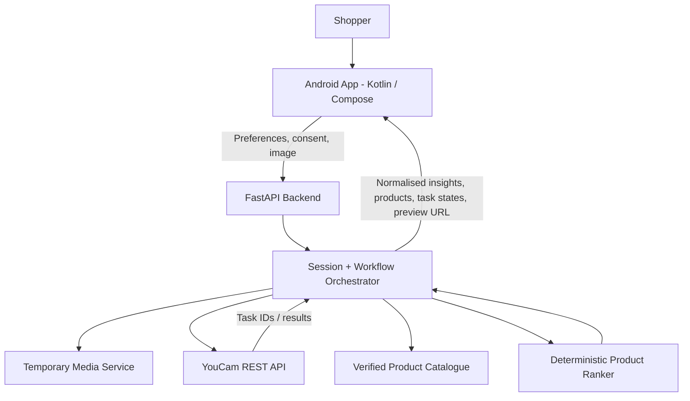
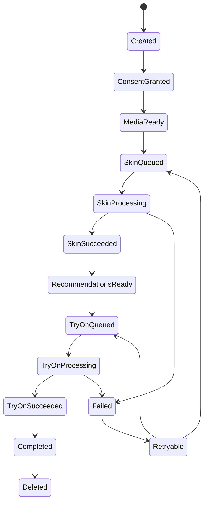

# Tonalique — System Architecture

**Version:** 0.1  
**Style:** Android client + FastAPI backend + YouCam REST APIs

---

## 1. Architecture decision

Build a **native Android app in Kotlin/Jetpack Compose** and a small **FastAPI backend**. Do not call YouCam directly from the Android client: the API credential must remain server-side. The backend also creates provider tasks, validates payloads, normalises provider responses and manages short-lived image references.



The Android client owns interaction and presentation. FastAPI owns secrets, provider calls, product matching and workflow state. YouCam owns AI image processing.

## 2. Android project structure

Suggested Gradle modules (a single app module is acceptable for the hackathon if modularisation slows delivery):

```text
android/
  app/
    src/main/java/.../tonalique/
      MainActivity.kt
      TonaliqueApp.kt
      navigation/AppNavGraph.kt
      ui/theme/{Color,Type,Shape,Theme}.kt
      core/model/
      core/network/
      core/datastore/
      feature/welcome/
      feature/preferences/
      feature/photo/
      feature/analysis/
      feature/recommendations/
      feature/tryon/
      feature/looks/
      feature/profile/
```

### Android responsibilities

- Request/handle photo picker and optional camera permission.
- Present a just-in-time consent step.
- Compress image to a reasonable JPEG size before upload; preserve quality needed for analysis.
- Submit app requests to FastAPI over HTTPS.
- Display asynchronous task states and results.
- Keep user preferences locally in DataStore.
- Save generated look metadata locally if the user opts in.
- Never embed YouCam API keys, provider Bearer tokens or long-lived signed upload credentials.

## 3. Backend structure

```text
backend/
  app/
    main.py
    config.py
    api/
      routes_sessions.py
      routes_media.py
      routes_analysis.py
      routes_recommendations.py
      routes_tryon.py
      routes_catalog.py
    schemas/
      session.py
      media.py
      analysis.py
      product.py
      tryon.py
    services/
      youcam_client.py
      media_service.py
      workflow_service.py
      catalog_service.py
      recommendation_service.py
      effect_registry.py
    repositories/
      task_repository.py
      catalog_repository.py
    tests/
```

### Backend responsibilities

- Load `YOUCAM_API_KEY` from environment/secret manager only.
- Enforce file type, size, dimensions and rate limits.
- Create an ephemeral session and task record.
- Prepare a provider-compatible image input using the verified YouCam upload workflow.
- Submit provider tasks and poll at a bounded interval or use webhook support if confirmed.
- Translate provider responses/errors into stable internal schemas.
- Serve a small, source-backed product catalogue.
- Rank products deterministically and test budget constraints.
- Delete temporary images and task data according to a documented retention policy.

## 4. Provider integration boundary

Create one adapter class, e.g. `YouCamClient`, rather than scattering raw HTTP calls throughout route handlers.

Methods:

```python
class YouCamClient:
    async def prepare_source_image(self, image_bytes: bytes, content_type: str) -> "PreparedSource": ...
    async def create_skin_analysis(self, source: "PreparedSource", actions: list[str]) -> str: ...
    async def get_skin_analysis(self, task_id: str) -> "ProviderTask": ...
    async def create_makeup_vto(self, source: "PreparedSource", effect_config: dict) -> str: ...
    async def get_makeup_vto(self, task_id: str) -> "ProviderTask": ...
```

`PreparedSource` must abstract the exact provider input mode (URL or file ID). That mode is not assumed to be identical across Skin Analysis and Makeup VTO; verify against current OpenAPI docs and the hackathon account before implementation.

## 5. Backend HTTP API contract

These are Tonalique's own endpoints, not YouCam endpoints.

### `POST /api/v1/sessions`

Create an anonymous demo session.

Response:
```json
{
  "session_id": "opaque-random-id",
  "expires_at": "2026-10-31T20:00:00Z"
}
```

### `POST /api/v1/media`

Multipart upload of the selected photo after consent. Validate file and create an ephemeral provider-compatible input. Return an opaque `media_id`; do not return API secrets.

Response:
```json
{
  "media_id": "opaque-media-id",
  "status": "ready",
  "delete_after": "2026-10-31T20:00:00Z"
}
```

`delete_after` in this example is a product policy field. Set the actual TTL from the implemented storage/provider flow; do not promise a duration that has not been built.

### `POST /api/v1/skin-analyses`

Request:
```json
{
  "session_id": "opaque-random-id",
  "media_id": "opaque-media-id",
  "actions": ["skin_type", "radiance", "redness", "oiliness"],
  "format": "json"
}
```

Response:
```json
{
  "analysis_id": "opaque-analysis-id",
  "status": "queued"
}
```

Use only a provider-supported set of actions. The current Skin Analysis v2.1 reference separates HD and SD actions and prohibits mixing them. The example above is a proposed SD-only set; verify every action is accepted in the target API version.

### `GET /api/v1/tasks/{task_id}`

Response:
```json
{
  "task_id": "opaque-analysis-id",
  "kind": "skin_analysis",
  "status": "processing",
  "result": null,
  "error": null
}
```

On success, `result` contains normalised provider-returned values and media links. On error, return a safe internal error code and user-facing next action; never expose raw provider stack traces.

### `POST /api/v1/recommendations`

Request:
```json
{
  "session_id": "opaque-random-id",
  "occasion": "everyday",
  "look": "soft_glam",
  "finish": "satin",
  "shade_preference": "warm",
  "budget_minor": 150000,
  "currency": "INR",
  "analysis_id": "opaque-analysis-id"
}
```

Response:
```json
{
  "recommendation_id": "rec-123",
  "currency": "INR",
  "budget_minor": 150000,
  "total_minor": 142000,
  "remaining_minor": 8000,
  "within_budget": true,
  "items": [
    {
      "product_id": "sku-001",
      "name": "Example Lip Colour",
      "price_minor": 79900,
      "currency": "INR",
      "reasons": ["Matches your selected satin finish", "Within your selected budget"],
      "source_url": "https://example.com/product"
    }
  ]
}
```

This example is a contract illustration, not a real product or price.

### `POST /api/v1/try-ons`

Request:
```json
{
  "session_id": "opaque-random-id",
  "media_id": "opaque-media-id",
  "product_id": "sku-001",
  "effect_config_id": "lip-rosewood-satin-v1"
}
```

Response:
```json
{
  "tryon_id": "tryon-123",
  "status": "queued"
}
```

The backend retrieves the effect configuration from an allow-listed registry. Do not accept arbitrary raw effect JSON from the mobile app.

### `GET /api/v1/try-ons/{tryon_id}`

Response on success:
```json
{
  "tryon_id": "tryon-123",
  "status": "success",
  "preview_url": "https://temporary-result-url.example/result.jpg",
  "disclaimer": "AI preview only; actual product appearance may vary."
}
```

### `DELETE /api/v1/sessions/{session_id}`

Delete the session's temporary media and ephemeral workflow data under Tonalique's control. Return `204` on successful deletion. Provider-side deletion/retention must be described separately based on provider contract and actual endpoint support.

## 6. Workflow state machine



The internal state machine must track whether a provider request was already accepted. Do not auto-resubmit a task when the client simply retries a timed-out request; use idempotency keys or server-side request state.

## 7. Image and task data flow

1. Android receives an image URI via Android Photo Picker (preferred) or camera capture.
2. User confirms photo and consent.
3. Android sends bytes to Tonalique FastAPI over HTTPS.
4. Backend validates format, size and dimensions; strips EXIF metadata.
5. Backend creates a private short-lived image reference and/or completes the documented YouCam File API upload.
6. Backend obtains the provider input required by each endpoint.
7. Backend starts the Skin Analysis task, stores only task reference/status, and returns a Tonalique task ID.
8. Backend polls at a bounded interval (or uses a verified webhook), normalises the result, and informs Android.
9. Product engine ranks catalogue items using preferences and permitted fields.
10. User selects a product; backend maps it to an approved VTO effect configuration.
11. Backend starts and polls Makeup VTO task; returns a temporary result URL.
12. On session deletion/expiry, Tonalique removes its temporary source files and workflow records. Provider retention is governed by the YouCam account terms and must not be misrepresented.

## 8. Security and secrets

Environment variables:

```dotenv
APP_ENV=development
API_BASE_URL=https://api.example.com
YOUCAM_API_BASE_URL=https://yce-api-01.makeupar.com
YOUCAM_API_KEY=replace_me
YOUCAM_TIMEOUT_SECONDS=30
MAX_UPLOAD_MB=8
SESSION_TTL_MINUTES=60
```

- Do not commit `.env` or API keys.
- Use `Authorization: Bearer <API_KEY>` server-to-provider only.
- Keep provider API base URL configurable for hackathon/sandbox account differences.
- Validate allow-listed MIME types and actual image content, not just filename extension.
- Set request size limits and per-session/per-IP task limits.
- Redact auth headers, signed URLs, image URIs and raw results from logs.
- Use HTTPS and a restrictive CORS policy (CORS is only relevant if a web client is added).
- Never return the YouCam API key to Android.

## 9. Error mapping

| Provider/client issue | Internal code | UI action |
|---|---|---|
| Invalid/missing API key | `PROVIDER_AUTH_FAILED` | Stop; alert developer/log safely |
| Unsupported action/payload | `PROVIDER_BAD_REQUEST` | Show retry after app update/config fix; don't loop |
| Insufficient units | `PROVIDER_CREDITS_EXHAUSTED` | Explain preview unavailable; don't auto-retry |
| Rate limit | `PROVIDER_RATE_LIMITED` | Wait and retry only after backoff |
| Invalid photo | `PHOTO_UNSUPPORTED` | Choose another photo |
| Provider task error | `PROVIDER_TASK_FAILED` | Start again only after user confirmation |
| Network timeout | `NETWORK_TIMEOUT` | Query existing task status before resubmitting |
| Result expired | `RESULT_EXPIRED` | Re-run only with user approval and available units |

## 10. Testing plan

### Backend unit tests

- Image validation and EXIF stripping.
- YouCam payload builders use only allow-listed actions/effects.
- Skin Analysis never mixes HD and SD action names.
- Provider `queued`/`processing`/`success`/`error` mapping.
- Product ranking deterministic for fixed inputs.
- Bundle subtotal never exceeds budget when `within_budget=true`.
- Missing catalogue values are not invented.
- API key never appears in API responses or logs.
- Duplicate request/idempotency behaviour.

### Android tests

- Navigation across primary flow.
- Consent required before upload.
- Error states and retry affordances.
- Large-text layout and TalkBack labels.
- Preview before/after alternate control.

### End-to-end test

Use one known-good, consented test image. Confirm real Skin Analysis and Makeup VTO tasks succeed. Capture request IDs and redacted logs; never record the API key or source image bytes.

## 11. Hosting recommendation

- Backend: Render, Railway, Fly.io or another HTTPS-capable host with secret environment variables.
- Android APK: public GitHub Release or another simple static HTTPS download route. Include checksum and installation instructions.
- Repository: public GitHub with MIT or Apache-2.0 licence, subject to code/dependency licence review.
- A lightweight public landing page may explain the app and link to APK, demo video and source, but the core product remains Android-native.

## 12. Open technical risk: Skin Analysis source input

The current Skin Analysis v2.1 API reference documents `src_file_url` as required and says it must be publicly accessible. Makeup VTO v1.0 documents request alternatives for `src_file_url` and `src_file_id`. Do not assume the same source-file field works for both tasks. Validate the exact file-upload and source-input workflow for each feature with the current official OpenAPI spec and a live request before locking the media architecture.

## 13. References

- [YouCam API introduction](https://docs.perfectcorp.com/develop/introduction)
- [YouCam Quick Start](https://docs.perfectcorp.com/develop/quick_start_guide)
- [Skin Analysis API v2.1](https://docs.perfectcorp.com/reference/ai_skin_analysis/v2.1)
- [Makeup VTO API v1.0](https://docs.perfectcorp.com/reference/makeup_vto/v1.0)
